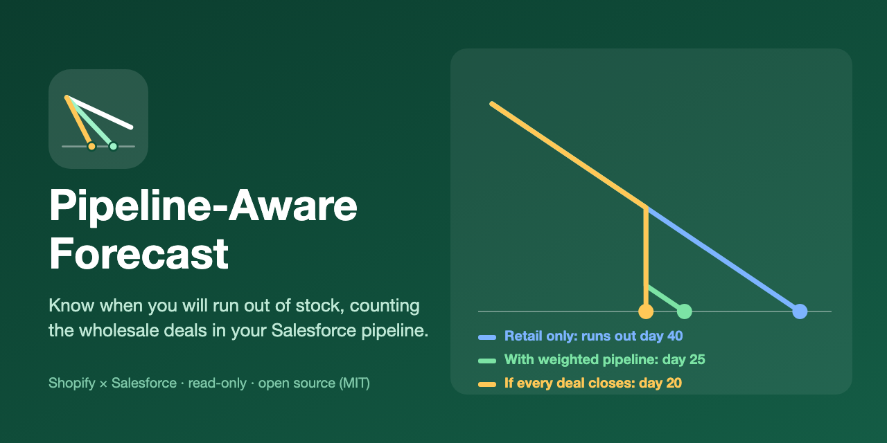
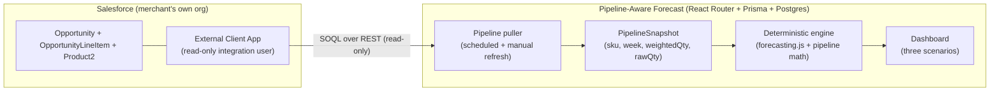
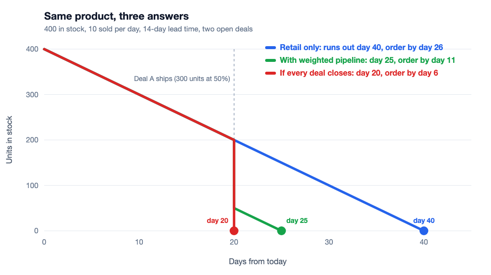

# Pipeline-Aware Forecast — Wholesale Demand from Salesforce, Inside Your Shopify Forecast



[](https://github.com/arsalan-arshad/pipeline-aware-forecast/actions/workflows/ci.yml) [](LICENSE)

> **Open-Source (MIT)** | Standalone Shopify app | Cross-platform: Shopify × Salesforce | Open for PRs & Discussions

> 🚧 **Status: Early development — not released, not installable.** Built and tested locally: the demand/stockout engine, a read-only Salesforce client, the sync and storage layer, and a Shopify app shell. **No Shopify app is registered, nothing is deployed, and the sections below still describe intended behaviour** except where the roadmap ticks a box. v1 will ship without the AI explain layer.

---

## 1. Overview & Vision

**The problem:** brands that sell direct on Shopify *and* wholesale through a Salesforce sales team have two demand streams but only one is visible to inventory planning. Retail demand is in Shopify's sales history; wholesale demand is sitting in open Salesforce Opportunities. Today an ops lead exports a pipeline report and eyeballs it against a stock sheet — and finds out about the collision when a big deal closes on stock the storefront already sold.

**The approach:** a deterministic, auditable calculation. No AI is involved in v1.
1. **A deterministic engine** turns open Opportunity line items into *forward B2B demand per SKU per week* (quantity × stage probability, placed on an expected ship date), merges it with retail demand, and re-computes stockout dates and reorder timing. Same inputs, same outputs, every number traceable to a formula.
2. **Three scenarios side by side** (retail only, weighted pipeline, if every open deal closes), so the merchant can see how much the answer depends on the CRM's probabilities. A grounded AI explanation layer is a possible later addition (see section 2E); it is not part of v1.

**Read-only by design:** v1 reads Salesforce and writes nothing to either platform.

---

## 2. Core Features (planned)

### A. Weighted pipeline demand
Open Opportunities → line items → matched to Shopify SKUs → per-SKU, per-week weighted quantity. Probability defaults to Salesforce's stage probability and can be overridden per stage; an optional merchant "haircut" factor shrinks optimistic pipelines.

### B. Combined burn-down and stockout date
A day-by-day stock simulation (retail daily demand + scheduled pipeline shipments) gives a stockout date and an *order-by* date (stockout minus lead time) for each SKU.

### C. Three scenarios, side by side
**Retail only** · **With weighted pipeline** · **If every open deal closes** (worst case). Merchants see the range, not a single falsely precise number.

### D. Guided setup + data-quality panel
Connection wizard with a *Test connection* button, stage-probability table, and an **Unmatched SKUs** panel listing Salesforce products that don't match any Shopify variant — so bad data is visible, not silently ignored.

### E. Grounded AI explanations _(planned, not built, not in v1)_
A possible later layer that would only *explain* the numbers in plain language and never create one. It would receive aggregated per-SKU figures only (never Salesforce account names or amounts). Nothing of this exists in the code today.

---

## 3. Architecture & Tech Stack



**Stack:** React Router 7 (Vite), Polaris, Prisma + PostgreSQL, AES-256-GCM for stored credentials, and a small Salesforce REST client written with plain `fetch`.

Layout of the engine (pure, tested functions; the app shell, routes and storage live under `app/`):
```
app/lib/pipeline/
├── pipeline-demand.js       # pure: opportunities → weighted weekly demand
├── burn-down.js             # pure: stock + demand streams → stockout/order-by dates
├── sku-matching.js          # pure: Salesforce ProductCode ↔ Shopify SKU rules
├── salesforce-client.server.js   # OAuth + SOQL, read-only
└── pipeline-sync.server.js  # scheduled pull → PipelineSnapshot
app/routes/app.settings.salesforce.jsx   # connection wizard + stage table
```

---

## 4. How the numbers work (worked example)

SKU `X`: 400 units in stock · retail average 10/day · lead time 14 days. Two open deals, expected to ship on day 20 and day 30:

| Deal | Units | Stage probability | Weighted units | Ships |
|---|---|---|---|---|
| A | 300 | 50% | 150 | day 20 |
| B | 200 | 20% | 40 | day 30 |

| Scenario | Stockout | Order-by (stockout − 14d) |
|---|---|---|
| Retail only | day 40 | day 26 |
| With weighted pipeline | day 25 | day 11 |
| Every open deal closes | day 20 | day 6 |

Between day 0 and 20 stock falls to 200; deal A takes 150 weighted units → 50 left, which retail demand empties by day 25. Probabilities come from the merchant's own CRM — the app reports the arithmetic, it does not claim to predict which deals close.

---



## 5. Permissions & Data Minimisation
- **Shopify:** read-only scopes only — `read_orders`, `read_products`, `read_inventory`, `read_locations`. As a separate app it requests them itself. Order data is Shopify "protected customer data" (Level 1: this app reads only SKUs and quantities, never customer fields), so the app must request that access in the Shopify dashboard and, for a public listing, pass Shopify's review.
- **Salesforce:** an **External Client App** in the merchant's own org (Salesforce has disabled creating new Connected Apps), a dedicated integration user with a read-only permission set on `Opportunity`, `OpportunityLineItem` and `Product2` only.
- **Stored:** per shop: the shop domain and install/uninstall/last-seen timestamps; the merchant's forecast settings; the Salesforce connection (instance URL and the client ID and secret, **encrypted with AES-256-GCM**); aggregated per-SKU, per-week quantities and deal counts; Salesforce product codes that matched no SKU (code, deal count, units); feedback messages the merchant chooses to submit (free text, optional 1–5 rating); Shopify's own session record.
- **Not stored:** Salesforce account names, contacts, deal amounts or notes; Shopify customer details; order contents beyond what is summed per SKU in memory.
- **Deletion:** on uninstall the Shopify session and the stored Salesforce credentials are deleted immediately; on `shop/redact` everything above is deleted.
- **Support:** the in-app Feedback page and Settings footer show the maintainer's address, arsalanarshad.dev@gmail.com.
- Credentials are supplied by the merchant, encrypted at rest (AES-256-GCM), and removed on uninstall / `shop/redact`.

---

## 6. Market Position
Shopify's forecasting apps (Prediko, Sumtracker, Inventory Planner, AIventory and others) forecast from retail sales history. None found so far uses CRM pipeline as a demand input; pipeline-to-inventory is today bespoke consulting work. The idea has so far been validated only on a dev store with seeded data; feedback from real merchants is welcome via Discussions.

---

## 7. Open-Source Roadmap & Good First Issues
- [x] Pure pipeline-demand and burn-down functions with fixture-based unit tests
- [x] Salesforce read-only client + connection test (client-credentials login; tested offline and against a Developer Edition org)
- [x] Settings UI: Salesforce connection (save / test / disconnect), stage probability table, haircut, ship offset, horizon and supplier lead time
- [x] Unmatched-SKU data-quality panel
- [x] Three-scenario view in the SKU table (dashboard) with a Refresh button and a scheduled sync endpoint
- [ ] `pipeline` block in the AI snapshot (aggregates only) — deferred; v1 ships without the AI layer
- [x] Seed script that creates sample Opportunities in a Developer Edition org (`scripts/seed-dev-org.apex`)
- [ ] Good first issue: unit-of-measure mapping (cases vs units)
- [ ] Good first issue: kit/bundle SKU expansion
- [ ] Later: read-only Salesforce LWC showing stock cover on the Opportunity record

---

## 8. Verification (commands that exist today)
- `npm test` — offline unit tests (engine, Salesforce client with a fake `fetch`, sync, crypto, store, Shopify reads with a fake client). The live and database suites below are skipped unless configured.
- `npm run test:integration` — live, read-only test against a Salesforce org; needs `SF_INSTANCE_URL`, `SF_CLIENT_ID`, `SF_CLIENT_SECRET` in a git-ignored `.env`.
- `npm run test:db` — runs the storage code against a real **local** Postgres; needs `PAF_TEST_DATABASE_URL` pointing at a localhost database whose name ends in `_test` (the test refuses anything else). See the header of `test/database.integration.test.js`.
- `npm run build` — builds the React Router app.
- GitHub Actions (`.github/workflows/ci.yml`) runs the tests (including the real-Postgres suite against a service container), applies the migrations and builds on every pull request.

Not verified yet: Shopify OAuth, webhook signature checks, App Bridge, and real Shopify query cost and throttling (they need a registered Shopify app and a dev store).

---

## 9. Self-hosting (production)
The app is a React Router (server-rendered) app with a Postgres database. Any host that runs Node and Postgres works; a single Railway service plus a Railway Postgres is enough.

**Environment variables** (names only; never commit values):
| Variable | Purpose |
|---|---|
| `DATABASE_URL` | Postgres connection string |
| `ENCRYPTION_KEY` | 64 hex characters (`openssl rand -hex 32`); encrypts stored Salesforce credentials. Losing or changing it makes stored credentials unreadable (merchants must reconnect). |
| `SHOPIFY_API_KEY`, `SHOPIFY_API_SECRET` | From your app in the Shopify Dev Dashboard |
| `SHOPIFY_APP_URL` | Public HTTPS address of your deployment |
| `SCOPES` | `read_inventory,read_locations,read_orders,read_products` |
| `CRON_SECRET` | 32+ random characters (e.g. `openssl rand -hex 24`); authorises the scheduled sync endpoint |

**Start command:** `npm run docker-start` (applies pending Prisma migrations, then starts the server). **Health check:** `GET /healthz` returns 200 `{"ok":true}` when the database answers and every variable is set.

**Scheduled sync:** point a cron job at the app, for example hourly: `curl -X POST -H "Authorization: Bearer $CRON_SECRET" "$SHOPIFY_APP_URL/internal/sync"`. Only shops whose last sync is older than six hours are synced (shops that failed in the last hour are skipped), and a per-shop lock prevents two syncs running at once.

**Shopify configuration:** set the real application and redirect URLs in `shopify.app.toml`, then deploy the configuration with the Shopify CLI. Reading orders requires protected-customer-data access (Level 1) to be requested for the app in the Shopify dashboard.

**Rotating `ENCRYPTION_KEY`:** back up the database, stop the app and the cron job, then run `OLD_ENCRYPTION_KEY=... NEW_ENCRYPTION_KEY=... DATABASE_URL=... node scripts/rotate-encryption-key.mjs` (all-or-nothing; prints only a count), set `ENCRYPTION_KEY` to the new key and start the app. Shopify access tokens in the `Session` table are encrypted with the same key, so after rotating, merchants simply reopen the app once (their sessions are re-created); Salesforce credentials are re-encrypted by the script.

**Known limits:** busy stores with very many orders can still hit Shopify's rate limits (reads are retried with backoff, and a bulk operation would be the proper fix for the very largest stores); sales velocity uses the last 28 days only; the dashboard caches Shopify stock and sales for up to a minute.

---

## 10. Local development
1. Start a local Postgres and create a database, e.g. `createdb paf_dev`.
2. Copy `.env.example` to `.env` and fill in `DATABASE_URL` (e.g. `postgresql://localhost:5432/paf_dev`), `ENCRYPTION_KEY` (`openssl rand -hex 32`), `CRON_SECRET`, and the Shopify values from your app (`shopify app config link`, then `shopify app env pull`).
3. `npx prisma migrate deploy` to create the tables.
4. `shopify app dev` (needs the Shopify CLI installed globally).

If `shopify app dev` fails with *"Prisma session table does not exist"*, the database is usually unreachable or the migrations were not applied: check that Postgres is running and that `DATABASE_URL` points at it, then run step 3.

Each `shopify app dev` start sends a test `APP_UNINSTALLED` webhook, which by design deletes the dev shop's session and saved Salesforce connection; reopen the app and save the connection again.

